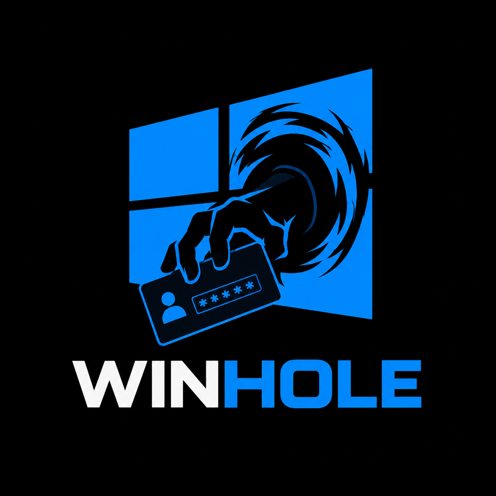

<p align="center">
  
</p>

# Winhole

A bootable USB stick that lets you reset a local Windows user's password on a
machine you own but got locked out of.

Winhole swaps `C:\Windows\System32\Utilman.exe` with a small Windows Forms tool.
When you boot Windows afterwards and click the accessibility icon on the lock
screen, the tool opens with system privileges, lists local accounts, and lets
you set a new password for one of them. A second boot from the stick restores
the original `Utilman.exe`.

Only use this on machines and accounts that are yours.

---

## How it works

1. The stick boots a tiny Linux (BusyBox + a static framebuffer animation).
2. The init script looks for the one NTFS partition that holds
   `Windows\System32\ntoskrnl.exe`.
3. If `Utilman.exe_bak` exists next to `Utilman.exe`, it is **restore mode**:
   the backup is moved back in place.
4. Otherwise it is **install mode**: `Utilman.exe` is saved as
   `Utilman.exe_bak` and replaced by the payload tool.
5. The machine reboots. You boot Windows normally, click the accessibility
   icon on the login screen, pick a user, set a new password.
6. Boot the stick a second time to put the original `Utilman.exe` back.

## Hard requirement: BitLocker must be OFF

Winhole mounts the Windows partition read-write from Linux using `ntfs3`. A
BitLocker-encrypted system partition cannot be opened this way, and even if it
could, writing to it would leave the volume in an unrecoverable state. If
BitLocker is active, Winhole simply refuses the operation and reboots.

**Before you flash the stick:** turn BitLocker off on the Windows machine
you want to recover. See [Turning BitLocker off and on](#turning-bitlocker-off-and-on)
below.

After you are done recovering the account, **turn BitLocker back on**.
Leaving a drive unencrypted is a real risk, not a formality.

---

## Repository layout

```
init                 BusyBox shell init that drives the swap/restore
fbanim.c             Static framebuffer animation player
make_frames.py       Builds the three raw frame files for the animation
makecross.py         Builds the sprite sheet from the cross icon (optional)
make_testdisk.sh     Builds a fake GPT/NTFS test image (used by rebuild.sh --test)
build.sh             Builds initramfs + recovery.iso
rebuild.sh           Rebuilds everything, optional QEMU install+restore test
flash-stick.sh       Flashes recovery.iso onto a USB stick (via Windows PowerShell)
grab.py              Debug helper: screendumps from QEMU over QMP
assets/src/PRH/      The C# WinForms tool that runs as Utilman.exe
assets/bin/          Published PasswordRecovery.exe lives here
initramfs/           Staged initramfs tree
```

---

## Building

The build is a Linux build. On Windows you need WSL (there is no native
Windows path). The `flash-stick.sh` script talks to the host's PowerShell
from inside WSL, so WSL is also the natural place to run it from.

### On Linux

Everything (the ISO, the initramfs, and the Windows WinForms tool) builds
from Linux. The .NET project targets `net10.0-windows`, which the .NET SDK
cross-publishes for `win-x64` from Linux. No Windows machine is involved.

Steps tested on Debian 13. On other distros the package names may differ,
but the set is the same.

**1. Install the build toolchain.**

```bash
sudo apt update
sudo apt install -y busybox-static gcc cpio zstd xz-utils grub-pc-bin \
                    grub-efi-amd64-bin xorriso mtools ntfs-3g python3-pil \
                    sfdisk qemu-system-x86 fuse3 git curl wget
```

You also need a Linux kernel installed whose modules live under
`/lib/modules/<version>/`. On Debian/Ubuntu that is `linux-image-amd64` (or
whichever kernel package your distro uses). The build picks the first module
set it finds under `/lib/modules/` that is not flagged `microsoft`.

**2. Install the .NET 10 SDK.**

Via Microsoft's APT feed:

```bash
wget -q https://packages.microsoft.com/config/debian/13/packages-microsoft-prod.deb -O /tmp/pmp.deb
sudo dpkg -i /tmp/pmp.deb && rm /tmp/pmp.deb
sudo apt update
sudo apt install -y dotnet-sdk-10.0
```

If `dotnet-sdk-10.0` is not in your distro's feed yet, use the official
install script:

```bash
curl -sSL https://dot.net/v1/dotnet-install.sh | bash -s -- --channel 10.0
echo 'export PATH="$HOME/.dotnet:$PATH"' >> ~/.bashrc
export PATH="$HOME/.dotnet:$PATH"
```

Verify with `dotnet --list-sdks`. Any `10.0.x` works.

**3. Clone and build.**

```bash
git clone https://github.com/wombat404/winhole.git
cd winhole
./build.sh
```

`build.sh` publishes the `.NET` tool with `dotnet publish` (single-file,
self-contained, `win-x64`), compiles `fbanim` statically, generates the
animation frames, packs the initramfs, and builds a hybrid BIOS/UEFI ISO
with `grub-mkrescue`. The final ISO lands at `/home/<you>/recovery.iso`.

Rebuilds and the QEMU install+restore test:

```bash
./rebuild.sh           # rebuild everything
./rebuild.sh --test    # also run the self-test in a QEMU window
```

### On Windows (through WSL)

The build is Linux-only. On Windows you run it inside WSL, which gives you a
real Linux where the exact same instructions apply.

1. Install WSL and a Debian distro from PowerShell:

   ```powershell
   wsl --install -d Debian
   ```

2. Reboot if WSL asks for it, then open the Debian shell.

3. Follow the Linux instructions above (toolchain, .NET SDK, clone, build).
   Install everything inside WSL. Do not call Windows' `dotnet.exe`; keep
   the whole build on the Linux side.

The ISO ends up at `/home/<you>/recovery.iso` inside WSL. From Windows you
can reach it under `\\wsl.localhost\Debian\home\<you>\recovery.iso` in
Explorer, or run `flash-stick.sh` from inside WSL to flash it straight to a
USB stick (it talks to the host via PowerShell for the UAC-elevated raw
write).

---

## Testing the ISO (without touching real hardware)

```bash
./rebuild.sh --test
```

This builds a 400 MiB GPT disk image with a fake Windows partition
(`Windows\System32\ntoskrnl.exe` + a stub `Utilman.exe`), boots the ISO in a
QEMU window against that image, and verifies the result by md5 hash. It runs
the install pass first, then a second boot for the restore pass.

The QEMU window closes on its own when init reboots.

---

## Flashing the stick

```bash
./flash-stick.sh
```

The script auto-detects whether it is running on native Linux or inside WSL
and picks the right method.

### On Linux

The stick must be plugged in and visible as a USB block device. The script
enumerates USB disks with `lsblk`, asks you to pick one, confirms with
`FLASH`, unmounts any mounted partitions, then writes the ISO with
`sudo dd`. You will be prompted for your sudo password.

### Inside WSL

Plug the stick into the Windows host (do **not** re-attach it to WSL via
`usbipd`). The script asks Windows for the list of USB disks via
PowerShell, launches an elevated PowerShell window that writes the ISO
directly to `\\.\PhysicalDriveN`, and takes the disk offline when it is
done. Confirm the UAC prompt when it appears.

---

## Using the stick to reset a password

1. Make sure BitLocker is off on the target machine (see below).
2. Shut Windows down fully. On modern Windows you may need to disable Fast
   Startup first (Control Panel -> Power Options -> Choose what the power
   buttons do -> Change settings that are currently unavailable -> uncheck
   "Turn on fast startup").
3. Plug the stick in and boot from it (boot menu is usually F8, F10, F11
   or F12 depending on the vendor).
4. The animation shows `doing the magic stuff` and then `installing`. The
   machine reboots on its own.
5. Boot Windows normally. On the login screen, click the accessibility icon
   (bottom right). The password tool opens.
6. Pick a user, type a new password (empty = `000000`), click
   **Set Password**.
7. Log in.
8. Boot from the stick a second time. The animation now shows `restoring`.
   `Utilman.exe` is put back the way it was.
9. **Turn BitLocker back on.**

---

## Turning BitLocker off and on

> Screenshots are placeholders. Replace them with real ones once you have
> them.

### Turning BitLocker OFF (before using Winhole)

**Step 1.** Open the Start menu, type `Manage BitLocker`, and press Enter.


<!-- SCREENSHOT NEEDED: Start menu with "Manage BitLocker" typed in the search box -->

**Step 2.** The BitLocker Drive Encryption window shows your drives. Find
the one with the Windows logo (usually `C:`) and click **Turn off
BitLocker**.


<!-- SCREENSHOT NEEDED: BitLocker control panel with "Turn off BitLocker" link visible next to the system drive -->

**Step 3.** Confirm in the dialog. Windows now decrypts the drive. This
takes a while (anywhere from minutes to hours depending on drive size and
amount of data).


<!-- SCREENSHOT NEEDED: Confirmation dialog "Are you sure you want to turn off BitLocker?" -->

**Step 4.** Wait until the status says **BitLocker off** before you shut
down and boot the stick.


<!-- SCREENSHOT NEEDED: BitLocker panel showing "BitLocker off" for the system drive -->

### Turning BitLocker ON (after you are done)

**Step 1.** Open **Manage BitLocker** again from the Start menu.


<!-- SCREENSHOT NEEDED: Start menu with "Manage BitLocker" typed again -->

**Step 2.** Next to the system drive, click **Turn on BitLocker**.


<!-- SCREENSHOT NEEDED: BitLocker panel with "Turn on BitLocker" link visible -->

**Step 3.** Choose how to back up your recovery key. **Save it somewhere you
can get to without this computer** (Microsoft account, a USB stick, a
printed copy). Losing the recovery key means losing the drive.


<!-- SCREENSHOT NEEDED: "How do you want to back up your recovery key?" dialog -->

**Step 4.** Pick **Encrypt used disk space only** for a faster first-time
encryption on an SSD, or **Encrypt entire drive** for a drive that was used
before.


<!-- SCREENSHOT NEEDED: "Choose how much of your drive to encrypt" dialog -->

**Step 5.** Pick **New encryption mode** (XTS-AES) for a fixed drive on this
PC.


<!-- SCREENSHOT NEEDED: "Choose which encryption mode to use" dialog -->

**Step 6.** Run the BitLocker system check and reboot. Once the drive is
being encrypted in the background you are back to a protected state.


<!-- SCREENSHOT NEEDED: "Are you ready to encrypt this drive?" with the system check option -->

---

## Troubleshooting

**Nothing happens on the login screen when I click the accessibility icon.**
The swap did not go through. BitLocker is almost always the reason. Confirm
BitLocker is off and that the disk is not in the hybrid shutdown / fast
startup state, then boot the stick again.

**The stick boots but reboots right away.** The init script could not find a
single Windows partition with `Windows\System32\ntoskrnl.exe`. Make sure the
right disk is plugged in and nothing else exposes a matching path.

**The animation never appears.** Framebuffer is missing or the GRUB entry
did not pick the right video mode. Check `grub.cfg` in `iso/boot/grub/` after
a build.

---

## Not what Winhole is for

Winhole is for people who own the machine. It is not a tool for accessing
accounts that are not yours. Flashing it to a stick does not help you around
BitLocker, a TPM-sealed drive, or any form of corporate device policy, and
nothing here is going to change that.
